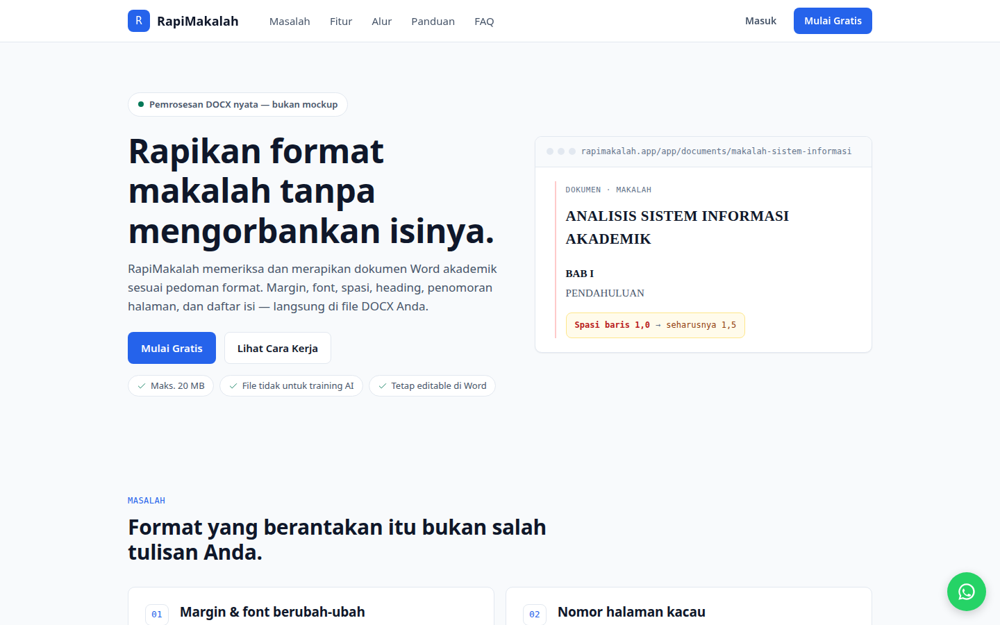
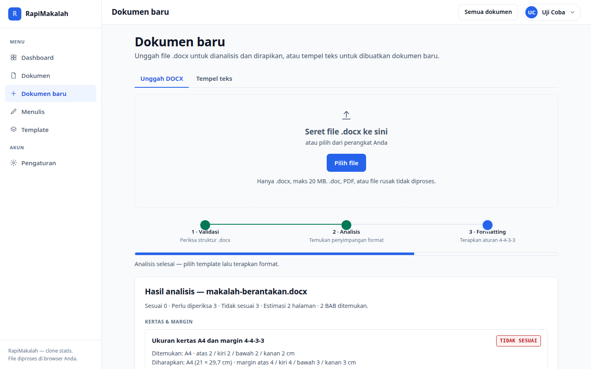
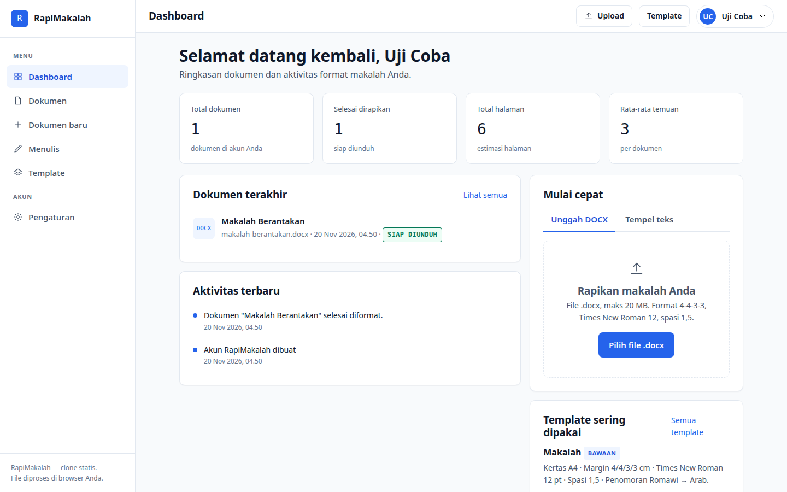
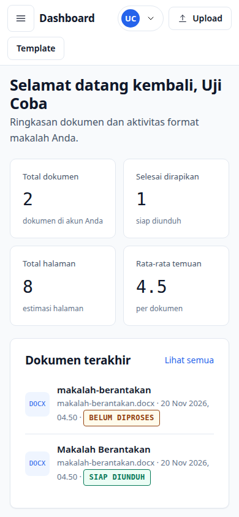

# RapiMakalah — clone statis

Clone dari [rapimakalah.my.id](https://rapimakalah.my.id/): merapikan format makalah
dan skripsi Word (`.docx`) secara otomatis — margin, font, spasi, heading BAB,
penomoran halaman Romawi → Arab, daftar isi, cover — langsung di browser,
tanpa backend dan tanpa file keluar dari perangkat Anda.

> **Status:** clone statis (HTML/CSS/JS murni, deploy Cloudflare Pages).
> Auth adalah **demo lokal** (localStorage, tanpa server). Mesin format DOCX-nya
> **nyata, bukan mock**: unggah `.docx` berantakan → analisis per seksi →
> terapkan format → unduh `.docx` hasil yang sudah rapi.

## Video demo

[](docs/demo.mp4)

Klik gambar di atas untuk memutar video demo (MP4, 16 detik, 524 KB):
landing → daftar → dashboard → unggah `.docx` → analisis 6 temuan →
terapkan format → unduh hasil.

## Tampilan

| Landing (desktop) | Analisis dokumen |
| --- | --- |
|  |  |

| Dashboard | Mobile |
| --- | --- |
|  |  |

## Aturan format yang dipakai

Satu angka konsisten di seluruh situs (lihat catatan inkonsistensi di bawah):

- Kertas **A4** (21 × 29,7 cm)
- Margin **4-4-3-3 cm** (atas 4, kiri 4, bawah 3, kanan 3)
- Font **Times New Roman 12 pt**, spasi baris **1,5**
- Heading **BAB** (Heading 1, 14 pt tebal), sub-bab `N.N` (Heading 2)
- Penomoran **Romawi** (i, ii, iii…) untuk bagian depan, **Arab** (1, 2, 3…)
  mulai dari 1 untuk isi; cover tanpa nomor
- **Daftar isi** sebagai field TOC Word (diperbarui saat dibuka di Word)
- **Cover** + kata pengantar untuk dokumen dari tempel-teks

## Cara jalan

```bash
npm install   # sekali saja (devDependencies: playwright + jszip)
npm run serve # http://127.0.0.1:8331
```

Tidak ada build step. Buka `http://127.0.0.1:8331/` dan daftar akun demo
(akun tersimpan di localStorage browser Anda saja).

```bash
npm run validate  # check-links + check-static (P0 anti-slop)
npm run smoke     # smoke test HTTP + engine
npm test          # playwright e2e (desktop 1440x900 + mobile 390x844)
npm run screenshots  # regenerasi docs/screenshots/*.png + og-image.png
npm run make-video   # rekam ulang docs/demo.mp4 (butuh ffmpeg)
```

## Alur pakai

1. **Unggah DOCX** (`/app/documents/new.html`) atau **Tempel teks** — file
   divalidasi dulu (signature ZIP `PK\x03\x04` + struktur OOXML
   `[Content_Types].xml` + `word/document.xml`).
2. **Analisis** — 6 seksi temuan: Kertas & margin, Font & ukuran, Spasi baris,
   Heading & struktur, Penomoran halaman, Daftar isi. Tiap temuan menunjukkan
   apa yang ditemukan vs yang diharapkan.
3. **Terapkan format** — `js/docx.js` memanipulasi `document.xml` langsung
   (JSZip, di-vendor ke `vendor/jszip.min.js`): section break sebelum BAB
   pertama (Romawi + titlePg), footer berisi field PAGE asli, heading
   digabung/diberi style, body di-justify TNR 12 spasi 1,5, field TOC disisipkan.
4. **Unduh `.docx`** — file hasil tersimpan di tab ini; unduh sebelum menutup
   tab (blob hasil hanya hidup di memori tab, localStorage tidak muat file besar).

Halaman lain: **Menulis** (editor + Format Cepat + draft), **Template**
(bawaan "Makalah" + template kustom + impor JSON), **Pengaturan**
(profil, ubah password, hapus akun, sesi).

## Struktur

```
index.html  login.html  register.html  forgot-password.html  og-image.png
app/            dashboard, dokumen, dokumen baru, menulis, template, pengaturan
css/            style.css (publik) + app.css (shell aplikasi)
js/             auth.js (demo localStorage, SHA-256) · store.js · docx.js (mesin)
                app.js (shell) · landing.js · toast.js
vendor/         jszip.min.js (v3.10.1, vendored — tanpa dependensi produksi)
e2e/            app.spec.js (14 tes x desktop + mobile) + fixtures/makalah-berantakan.docx
scripts/        serve.mjs · smoke.mjs · check-links.mjs · check-static.mjs
                advisory-sweep.py · screenshots.mjs · make-video.mjs
docs/           screenshots/*.png · demo.mp4
DESIGN.md       kontrak desain (palet, tipografi, detail khas)
```

## Catatan jujur (bukan mock, tapi ada batasnya)

- **Pratinjau di aplikasi bersifat struktural** — yang diubah adalah XML
  `.docx`, bukan render Word. Nomor halaman dan daftar isi baru terisi penuh
  saat file dibuka di Microsoft Word / LibreOffice (field PAGE dan TOC
  diperbarui di sana).
- **Blob hasil hanya di memori tab.** Daftar dokumen menyimpan metadata di
  localStorage; tombol Unduh di daftar dokumen nonaktif bila tab sudah
  ditutup/dibuka ulang — unduh hasil langsung setelah format diterapkan.
- **Auth demo, bukan produksi.** Password hanya disimpan sebagai hash SHA-256
  di localStorage Anda; tidak ada server, tidak ada login Google, tidak ada
  kirim email. Kode reset password 6 digit ditampilkan di layar (demo, tanpa
  mail server), berlaku 15 menit.
- **File tidak pernah diunggah ke mana pun.** Semua pemrosesan terjadi di
  browser Anda (JSZip + DOMParser lokal).
- **Perbedaan dari aslinya (per 20 Nov 2026):**
  - Hero dan alur landing mengikuti versi live **20 Nov 2026**
    ("Rapikan format makalah tanpa mengorbankan isinya.", alur 4 langkah).
    Peta 19 Nov mencatat hero lama ("Rapi, sesuai format…", 3 langkah) + FAQ
    — FAQ dan popup WhatsApp dipertahankan sebagai pelengkap.
  - `/forgot-password` di situs asli **mati (404)**; di clone ini diperbaiki
    menjadi halaman reset yang berfungsi (kode demo di layar).
  - **Inkonsistensi margin asli disatukan:** teks template asli bilang
    4-3-3-3 sementara chip-nya 3/3/3/4. Clone ini memakai **4-4-3-3**
    di mana-mana, sesuai aturan tertulis di landing aslinya
    (meta description: "margin 4-4-3-3").
  - Nomor WhatsApp di popup adalah contoh (`6281234567890`) — nomor asli
    tidak diketahui.
- **Font UI** memakai Source Sans 3 + JetBrains Mono (bukan Inter seperti
  aslinya) dan palet mengikuti situs asli (biru `#2563EB` solid, tanpa gradien)
  — lihat `DESIGN.md`.

## Lisensi

MIT — lihat [LICENSE](LICENSE).
